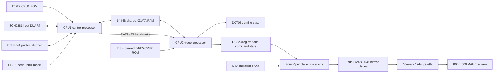

# VT340 MAME project summary

## Mission

This project is a ROM-level emulation of the Digital Equipment Corporation
VT340 video terminal for MAME. The goal is to run the original DEC firmware
against modeled board hardware until the terminal behaves like the physical
machine. Terminal protocols, startup messages, and graphics operations must
come from the ROMs; the driver must not replace firmware decisions with a
high-level terminal implementation.

The current driver boots both processors, completes the modeled destructive
hardware tests, exchanges the CPU1/CPU2 startup handshakes, executes native
graphics command packets, and displays the firmware-rendered `Wait` message.
It does not yet reach the documented persistent `VT340 OK` display.

The MAME source is `src/mame/dec/vt340.cpp`. Research notes, disassemblies,
reproduction scripts, and tests live under `vt340-research/`.

## Architecture

### Processor and ROM organization

- CPU1 controls the terminal, serial devices, keyboard path, configuration,
  and command production. The physical board identifies an Intel 8031, but
  current firmware execution requires indirect RAM through address `8c`.
  The driver therefore uses the otherwise compatible I8032 RAM organization
  while the hardware/firmware discrepancy remains unresolved.
- CPU2 performs video POST, timing work, command dispatch, and graphics setup.
  It uses the MAME I8031 core.
- Both processors run from the board's 12 MHz clock.
- CPU1 maps E1 at `0000-7fff` and E2 at `8000-ffff`.
- CPU2 maps E3 at `0000-7fff`; P3.3 selects E4 or E5 in the upper half.
- The published dumps are displaced by one byte. ROM declarations rotate the
  files during load and reconstruct individually proven corrupt boundary and
  checksum bytes with `ROM_FILL`. The original ROM files are not modified.

### Shared memory and communication

Both processors access a common 64 KiB XDATA store corresponding to E93/E94.
The first-stage model provides common storage but does not yet emulate bus
contention or arbitration delays.

Known communication mechanisms include:

- `7ff1`: CPU1/CPU2 initialization completion mailbox.
- `7ff2`: startup request and CPU2 POST result exchange.
- `7e00-7e7d`: command-ring data.
- `7e7e`: CPU1 producer index.
- `7e7f`: CPU2 consumer index.
- CPU2 P1.1 and CPU1 P3.5/T1: the bidirectional DAT9 startup handshake.
- DC323 active-low interrupt request: CPU2 INT0/frame service.

Short DAT9/T1 pulses are retained only at the firmware's known rendezvous so
they survive MAME scheduling boundaries. A 10 microsecond maximum quantum and
CPU1 perfect quantum keep both processors synchronized during startup.

### CPU1 peripherals

- E61 is modeled with MAME's SCN2681 DUART and drives CPU1 INT0.
- E81 is modeled with MAME's SCN2641 interface and drives CPU1 INT1.
- Disconnected receive inputs idle at the serial marking level.
- The keyboard uses CPU1's internal UART. The current provisional model sends
  an LK201 successful power-on response (`01 00 00 00`) after 70 ms.
- Reserved CPU1 SFR `c2` reads as `ff`, matching the value required by the
  firmware's formatter path.

### CPU2 video subsystem

CPU2's XDATA handler separates shared RAM from the decoded video apertures:

- DC323 Adder registers in the mirrored `f?00-f?3f` window.
- E51/E52 16-entry red and green/blue palette apertures.
- DC7051 low/high timing-register apertures.
- E80 EEPROM at `e600-e7ff` after POST ownership changes.
- Diagnostic bitmap and graphics POST behavior.

The raster path retains DC323 origins, extents, scale, mode, masks, source
selection, and Viper logic functions. It supports the proven E49-to-bitmap
and bitmap-to-bitmap normal operations used during startup. E49 is decoded
using the schematic address permutation and supplies the authentic DEC 10x20
glyphs.

Four 1024 x 2048 one-bit planes form a four-bit color index. The screen uses
the measured 32.3174 MHz timing: 1026 total by 526 lines, with an 800 x 500
visible area. Firmware-programmed complete palette entries display as 12-bit
RGB; entries not yet initialized after graphics POST use a monochrome
visibility fallback.

### State and lifecycle

`machine_start` installs the reserved-SFR behavior, allocates timing and
keyboard timers, initializes persistent storage, registers save-state items,
and installs exit diagnostics. `machine_reset` resets all modeled latches,
registers, interrupts, serial inputs, bitmap planes, timers, and trace limits.

The driver is registered as `MACHINE_NOT_WORKING | MACHINE_NO_SOUND`. Sound
has not been investigated, and the terminal has not completed the documented
successful startup sequence.

## Engineering approach

### Evidence first

Hardware behavior is added only when supported by schematics, DEC chipset
documentation, ROM disassembly, or controlled firmware execution. Unknown
registers and signals remain explicit unknowns instead of receiving convenient
values without a firmware dependency.

### Firmware-driven behavior

The driver models inputs, registers, storage, timing, and signal semantics.
It does not manually draw startup strings, inject success packets, or branch
on program counters to declare startup complete. Graphics output is accepted
only when original firmware submits the corresponding operations.

Some PC-qualified behavior remains where the physical decode is not fully
reconstructed. These cases are documented as provisional compatibility
behavior and are not treated as final hardware models.

### ROM reconstruction standard

A damaged dump byte is reconstructed only when surrounding instruction flow,
call contracts, runtime behavior, and the ROM's own checksum constrain the
value. Each reconstruction is documented next to its `ROM_FILL`. This has
replaced earlier synthetic continuations with native firmware execution.

### Controlled experiments

Hypotheses are tested at the firmware decision point using bounded debugger
scripts. Experimental state changes are not compiled into the production
driver. A useful experiment must identify the expected and observed state,
change only that state, and record the resulting native execution path.

### Deterministic validation

The repository provides:

- A targeted MAME build and ROM verification procedure in `BUILDING.md`.
- A basic executable/ROM smoke test in `tests/smoke.sh`.
- A Phase 2 normal-path and controlled-handshake regression in
  `tests/phase2-closeout.sh`.
- Concise timestamped evidence in
  `traces/wait-to-ok/phase2-event-summary.txt`.

Large raw debugger traces and screenshots remain local generated artifacts.
Tracked Lua scripts and disassemblies make the important paths reproducible.

## Current boot path

1. CPU1 and CPU2 execute their ROM tests and board initialization.
2. CPU1 and CPU2 exchange DAT9/T1 handshakes and shared mailbox values.
3. CPU2 reports POST success with `7ff2=80`.
4. CPU2 renders `Wait` from E49 and sets latch `60bb=01`.
5. CPU1 submits its initial graphics command stream; CPU2's repaired native
   dispatcher consumes it normally.
6. CPU1 reaches `41f7` with `B=40`, takes the `B.6` retry path, and does not
   submit command 32 during an ordinary boot.
7. A debugger-only clear of `B.6` makes original CPU1 firmware submit command
   32. CPU2 executes handler `db98`, then waits at `dc02` because producer
   `7e7e` equals consumer `7e7f`.
8. A bounded diagnostic ring transition makes native firmware branch through
   `dc18` and clear `60bb` at `dc1c`. The real source of that event is not yet
   known, so no equivalent behavior exists in the production driver.

## Known provisional or incomplete behavior

- CPU1 uses I8032 internal RAM behavior despite the documented 8031 part.
- Short DAT9/T1 handshakes use narrowly scoped pulse retention.
- The LK201 power-on reply is synthesized rather than produced by a keyboard
  device.
- E80 has no dump and starts erased.
- Some graphics POST/status behavior remains PC-qualified.
- Destination-only/source-2 operations, fill modes, scrolling, complete
  palette initialization, and sound are incomplete.
- Shared-memory arbitration timing is not modeled.
- The successful `VT340 OK` startup display is not reached.

## Repository guide

| Location | Purpose |
|---|---|
| `src/mame/dec/vt340.cpp` | MAME driver and ROM declarations |
| `vt340-research/firmware/` | Disassembly findings and firmware control flow |
| `vt340-research/hardware/` | Hardware maps, video model, and open questions |
| `vt340-research/traces/` | Reproduction scripts and concise trace summaries |
| `vt340-research/tests/` | Smoke and deterministic closeout tests |
| `vt340-research/tools/` | ROM inspection and E49 decoding utilities |
| `vt340-research/SPRINT_STATUS.md` | Current sprint result and next work |
| `vt340-research/PHASE3_PLAN.md` | Next investigation plan and acceptance criteria |
