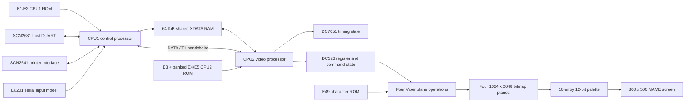

# VT340 MAME project summary

## Mission

This project is a ROM-level emulation of the Digital Equipment Corporation
VT340 video terminal for MAME. The goal is to run the original DEC firmware
against modeled board hardware until the terminal behaves like the physical
machine. Terminal protocols, startup messages, and graphics operations must
come from the ROMs; the driver must not replace firmware decisions with a
high-level terminal implementation.

The current driver boots both processors, completes the modeled destructive
hardware tests, exchanges the CPU1/CPU2 startup handshakes, executes native
graphics command packets, and displays the firmware-rendered `Wait` message.
It does not yet reach the documented persistent `VT340 OK` display.

The MAME source is `src/mame/dec/vt340.cpp`. Research notes, disassemblies,
reproduction scripts, and tests live under `vt340-research/`.

## Architecture

### Processor and ROM organization

- CPU1 controls the terminal, serial devices, keyboard path, configuration,
  and command production. It uses the schematic-correct MAME I8031 core.
  Earlier experiments used I8032 storage to accommodate a later serial-service
  stack excursion through address `8c`; that compatibility substitution has
  been removed. The current startup path and Phase 2-4 boundary are unchanged,
  while the later stack excursion remains an open risk once startup advances.
- CPU2 performs video POST, timing work, command dispatch, and graphics setup.
  It uses the MAME I8031 core.
- Both processors run from the board's 12 MHz clock.
- The shared MCS-51 core models SBUF's direction-selected hardware latches:
  writes start transmission without overwriting the receive value returned by
  reads. This is required by CPU1's negative-loopback POST.
- CPU1 maps E1 at `0000-7fff` and E2 at `8000-ffff`.
- CPU2 maps E3 at `0000-7fff`; P3.3 selects E4 or E5 in the upper half.
- The published dumps are displaced by one byte and have a systematic page-
  transition artifact. The driver retains the raw files, reconstructs all 630
  recoverable page-final positions at initialization, and derives each missing
  checksum tail from the firmware's rotate/XOR test. The original ROM files
  are not modified; see `firmware/rom-dump-reconstruction.md`.

### Shared memory and communication

Both processors access a common 64 KiB XDATA store corresponding to E93/E94.
The first-stage model provides common storage but does not yet emulate bus
contention or arbitration delays.

Known communication mechanisms include:

- `7ff1`: CPU1/CPU2 initialization completion mailbox.
- `7ff2`: CPU1 pending sentinel and CPU2 checkpoint/final-result state.
- `7e00-7e7d`: command-ring data.
- `7e7e`: CPU1 producer index.
- `7e7f`: CPU2 consumer index.
- CPU2 P1.1 and CPU1 P3.5/T1: the bidirectional DAT9 startup handshake.
- DC323 active-low interrupt request: CPU2 INT0/frame service.

Short DAT9/T1 pulses are retained only at the firmware's known rendezvous so
they survive MAME scheduling boundaries. Controlled Phase 4 tests removed the
former perfect-quantum selection, 10 microsecond maximum quantum, and
request-specific retained pulse without changing the startup event sequence.

### CPU1 peripherals

- E61 is modeled with MAME's SCN2681 DUART and drives CPU1 INT0.  Channel A is
  exposed as the Comm 1 RS-232/DEC-423 endpoint and channel B as Comm 2; both
  accept standard MAME serial devices including a macOS pseudo-terminal.
- E81 is modeled with MAME's SCN2641 interface and drives CPU1 INT1.
- Disconnected receive inputs idle at the serial marking level.
- The keyboard uses CPU1's internal UART and MAME's ROM-driven `lk201_device`.
  CPU1 P3.1/TXD drives the keyboard receive input and the keyboard transmitter
  drives CPU1 P3.0/RXD. This replaces the former timer-generated power-on
  response.
- Reserved CPU1 SFR `c2` reads as `ff`, matching the value required by the
  firmware's formatter path.

### CPU2 video subsystem

CPU2's XDATA handler separates shared RAM from the decoded video apertures:

- DC323 Adder registers in the mirrored `f?00-f?3f` window.
- E51/E52 16-entry red and green/blue palette apertures.
- DC7051 low/high timing-register apertures.
- Diagnostic bitmap and graphics POST behavior.

E80 is a CPU1-owned Xicor X2804 EEPROM. Its recovered 512-byte `23-001N2`
image is read through CPU1's E10-selected `f000-f1ff` aperture. The image
passes the ROM's native checksums and clears `NVR Error - 1`. EEPROM program
timing and persistence remain unmodeled because the proven startup path is
read-only.

The raster path retains DC323 origins, extents, scale, mode, masks, source
selection, and Viper logic functions. It supports the proven E49-to-bitmap
and bitmap-to-bitmap normal operations used during startup. E49 is decoded
using the schematic address permutation and supplies the authentic DEC 10x20
glyphs. DC323 completion status now follows command lifecycle, and
bitmap-to-processor FIFO reads can source either E49 or ordinary off-screen
bitmap storage. This releases normal foreground processing after status-line
drawing and allows F3 to enter the original firmware's complete Set-Up
directory.

Four 1024 x 2048 one-bit planes form a four-bit color index. The screen uses
the measured 32.3174 MHz timing: 1026 total by 526 lines, with an 800 x 500
visible area. Firmware-programmed complete palette entries display as 12-bit
RGB; entries not yet initialized after graphics POST use a monochrome
visibility fallback.

### State and lifecycle

`machine_start` installs the reserved-SFR behavior, allocates timing and
keyboard timers, initializes persistent storage, registers save-state items,
and installs exit diagnostics. `machine_reset` resets all modeled latches,
registers, interrupts, serial inputs, bitmap planes, timers, and trace limits.

The driver is registered as `MACHINE_NOT_WORKING | MACHINE_NO_SOUND`. Sound
has not been investigated, and the terminal has not completed the documented
successful startup sequence.

## Engineering approach

### Evidence first

Hardware behavior is added only when supported by schematics, DEC chipset
documentation, ROM disassembly, or controlled firmware execution. Unknown
registers and signals remain explicit unknowns instead of receiving convenient
values without a firmware dependency.

### Firmware-driven behavior

The driver models inputs, registers, storage, timing, and signal semantics.
It does not manually draw startup strings, inject success packets, or branch
on program counters to declare startup complete. Graphics output is accepted
only when original firmware submits the corresponding operations.

Some PC-qualified behavior remains where the physical decode is not fully
reconstructed. These cases are documented as provisional compatibility
behavior and are not treated as final hardware models.

### ROM reconstruction standard

A damaged dump byte is reconstructed only when surrounding instruction flow,
call contracts, runtime behavior, and the ROM's own checksum constrain the
value. The reconstruction algorithm and its independently constrained
descriptor repair are documented in `firmware/rom-dump-reconstruction.md`.
This has replaced earlier synthetic continuations with native firmware
execution.

### Controlled experiments

Hypotheses are tested at the firmware decision point using bounded debugger
scripts. Experimental state changes are not compiled into the production
driver. A useful experiment must identify the expected and observed state,
change only that state, and record the resulting native execution path.

### Deterministic validation

The repository provides:

- A targeted MAME build and ROM verification procedure in `BUILDING.md`.
- A basic executable/ROM smoke test in `tests/smoke.sh`.
- A Phase 2 normal-path and controlled-handshake regression in
  `tests/phase2-closeout.sh`.
- A Phase 3 low-ROM and operational-entry checkpoint in
  `tests/phase3-checkpoint.sh`.
- A complete recoverable-ROM boundary audit in
  `tests/rom-boundary-audit.sh`.
- The current synchronization boundary in
  `traces/phase4-sync-baseline.lua`.
- Concise timestamped evidence in
  `traces/wait-to-ok/phase2-event-summary.txt`.

Large raw debugger traces and screenshots remain local generated artifacts.
Tracked Lua scripts and disassemblies make the important paths reproducible.

## Current boot path

1. CPU1 holds CPU2 in reset while it executes its ROM and board tests.
2. CPU1 releases CPU2; both processors complete their native startup and
   DAT9/T1 rendezvous paths.
3. CPU2 renders `Wait` from E49 and begins its graphics configuration.
4. CPU2 publishes the `7ff2=00` checkpoint at approximately 8.228779 s.
5. CPU1 emits its next DAT9 pulse approximately 6.898 ms later, but does not
   install pending sentinel `7ff2=10` until approximately 8.295773 s.
6. CPU1 waits for a checkpoint that CPU2 has already issued. CPU2 later
   writes the authentic `7ff2=80` result and enters operational E4 firmware.
7. CPU1's bounded checkpoint loop expires at approximately 119.955290 s,
   immediately consumes the retained `80` in its terminal-result stage, and
   enters native startup routine `4551` at approximately 119.995547 s.
8. After removal of the incorrect PC-qualified DC323 bit-0 inversion, CPU2
   drains all startup packets. CPU1 completes both `7289` passes and submits
   command 32 at 121.688120 s.
9. CPU2 executes handler `db98` and reaches its completion-event wait at
   `dc02` at 122.047438 s with producer and consumer both `66` and `60bb=01`.
10. During command 32, CPU2 issues documented PBT command `0bc4` and reads
    1,024 bytes of localized startup text from E49 into `cc00-cfff`. With the
    register-7 FIFO modeled, the firmware replaces `Wait` with four specific
    POST errors selected by CPU1's result byte. E80 and SCN2681 corrections
    have reduced that byte from `63` to `40`.

The older command-32/ring experiment remains valid Phase 2 control-flow
evidence, but the corrected ROM baseline exposes this earlier Phase 4
sentinel/checkpoint ordering as the first fast-path timing mismatch. CPU2
never reads `7ff2`; `10` is a stale-zero guard, not a request notification.

## Known provisional or incomplete behavior

- CPU1 is back on the documented I8031 core; the previously observed later
  serial-service stack excursion above `7f` remains unresolved.
- Short DAT9/T1 handshakes use narrowly scoped pulse retention.
- The exact LK201 ROMs are connected through MAME's ROM-driven keyboard
  device; keyboard timing does not change the checkpoint mismatch.
- The 512-byte E80 `23-001N2` dump has been recovered, but its E10-latched
  CPU1 bus interface is not yet modeled.
- Some graphics POST/ready behavior remains PC-qualified; the operational
  DC323 interrupt status path is no longer PC-qualified.
- Destination-only/source-2 operations, fill modes, scrolling, complete
  palette initialization, and sound are incomplete.
- Shared-memory arbitration timing is not modeled.
- The firmware now exits `Wait`; E80, both SCN2681 channels, and the SCN2641
  printer diagnostic all pass, and CPU1 submits POST result `00`. The original
  `VT340 OK` panel is visible; clearing the old `Wait` glyph and stabilizing
  the panel remain display-state work rather than POST work.

## Repository guide

| Location | Purpose |
|---|---|
| `src/mame/dec/vt340.cpp` | MAME driver and ROM declarations |
| `vt340-research/firmware/` | Disassembly findings and firmware control flow |
| `vt340-research/hardware/` | Hardware maps, video model, and open questions |
| `vt340-research/traces/` | Reproduction scripts and concise trace summaries |
| `vt340-research/tests/` | Smoke and deterministic closeout tests |
| `vt340-research/tools/` | ROM inspection and E49 decoding utilities |
| `vt340-research/SPRINT_STATUS.md` | Current sprint result and next work |
| `vt340-research/PHASE3_CLOSEOUT.md` | Completed Phase 3 evidence and Phase 4 handoff |
| `vt340-research/PHASE4_PLAN.md` | Active synchronization investigation and acceptance criteria |
