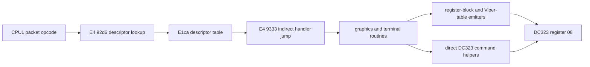

# DC323 firmware command dispatch

## Finding

CPU2 does not have one switch statement whose cases correspond directly to
DC323 raster modes.  Command generation is layered:

The first dispatch chooses a CPU2 service routine.  That service routine can
call several lower-level drawing primitives, and those primitives select the
DC323 operation either from ROM data tables or with immediate command values.
Consequently, a DC323 mode cannot be assigned to a packet opcode merely by
looking at the `e1ca` table; the handler's call path must also be traced.

## CPU1-to-CPU2 descriptor dispatch

The dispatcher is in the E4 bank at `92d6-9333`:

1. `92d6` multiplies the packet opcode in R3 by three.
2. `92de` rejects offsets at or above `ca`, bounding the table to opcodes
   `00-42`.
3. `92e0` selects the descriptor table at `e1ca`.
4. Each descriptor is three bytes: payload length, handler low byte, handler
   high byte.
5. `92f9-92ff` stores the handler at shared RAM `60ab/60ac` and the payload
   length at `60ad`.
6. After the payload is collected, `9327-9333` loads the handler and executes
   `JMP @A+DPTR`.

Relevant descriptors observed while bringing up the display include:

| Packet | Length | Handler | Observed role |
|---:|---:|---:|---|
| `08` | 1 | `c4b7` | display initialization state |
| `0c` | 0 | `caf5` | display/session initialization |
| `21` | 2 | `c569` | repaired descriptor used by normal packet framing |
| `24` | 1 | `ccc6` | display setup activity |
| `2c` | 5 | `d40e` | previously traced control packet handler |
| `32` | 1 | `db98` | main screen/session reconstruction path |

This is the firmware's clearest conventional switch-like construct, but its
cases are interprocessor services rather than individual raster operations.

## DC323 table emitters

Two almost identical families turn ROM records into DC323 writes.

### General register blocks

- Common low ROM `27eb`: reads a count followed by records containing register
  number, high byte, and low byte, then writes each 16-bit value to the DC323.
- E4 `bb5f`: the bank-local equivalent.  A table record with register `08`
  submits a command.

These routines explain why the command value is not always visible as an
immediate constant near the high-level graphics routine.

### Viper register blocks

- Common low ROM `2804`.
- E4 `bb76`.

Each record writes a 16-bit value through DC323 I/D register `07`, then submits
an `0180-019f` command through register `08` to load the selected Viper
register.

## Direct command primitives

The firmware also contains small primitives whose command is immediate.  The
most active examples in the current traces are:

| Write PC reported by tap | Command | Routine purpose |
|---:|---:|---|
| `1bc8` | `0bc0` | bitmap-to-processor transfer helper |
| `1c27` | `06c0` / `0ec0` / `06f0` | shared raster primitive tail selected by entry point |
| `28d5` | `06e0` | shared raster helper |
| `28e2` | `06f0` | shared raster helper |
| `031c` | `0ee0` | shared low-ROM raster submission |
| `c217` | `0ec0` | E4 raster submission |

The write tap reports the PC after the `MOVX`, hence entries such as `1c27`
refer to the write at `1c26`.

## Controlled trace result

`traces/dc323-command-provenance.lua` records the emitting PC, active E4/E5
bank, command, X-control value, most recently selected descriptor handler, and
the raw CPU2 return stack.  A 20-second optional-fast-start cold boot produced
11,686 command-register writes in 95 unique provenance groups.  This includes
the destructive POST register tests, Viper loads, and operational drawing.

The trace proves both construction styles are live:

- POST and setup make extensive use of E4 table writers `bb6f` and `bb8d`.
- Operational drawing uses common low-ROM direct primitives such as `031c`,
  `1bc8`, and `1c27`, plus E4 primitives such as `c217`.
- Commands emitted while the `930e` dispatcher return frame was present were
  associated with handlers `caf5`, `ccc6`, and `db98` in this run.

The handler stored in `60ab/60ac` persists after a handler returns.  The trace
therefore marks a command as actively dispatched only when return address
`930e` is also present in the captured CPU2 stack; the handler value alone is
not treated as proof of ownership.

## How to map unsupported modes

For a targeted ReGIS or SIXEL workload, group command writes by:

1. X-control mode and raw command bits;
2. emitting PC;
3. active descriptor handler when the `930e` frame is present;
4. return addresses above the emitter;
5. the ROM table address supplied to `27eb`, `2804`, `bb5f`, or `bb76`.

That produces the exact firmware path for source-2, fill/hole-fill, indexed,
or transfer commands without assuming that the top-level packet opcode is the
raster-mode selector.
