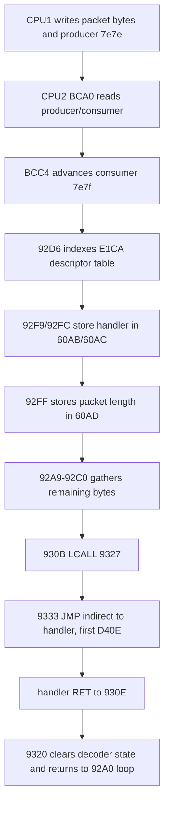
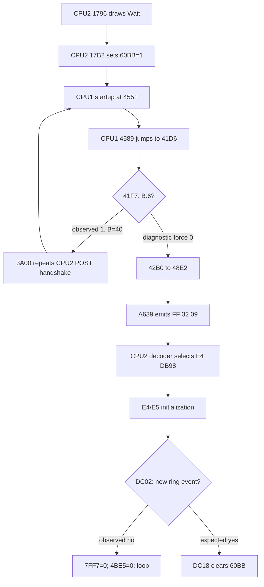

# `Wait` to `VT340 OK` investigation

This file records the repeatable baseline, dispatcher repair, and Phase 2
trace from the temporary `Wait` display to the exact unresolved completion
handshake.

## Phase 0: deterministic baseline

Three independent 20-second cold boots used the same binary, ROM set, runtime
arguments, and screenshot script. All three event logs were byte-identical
(`SHA-256 a45955b8cd217870da3d0acfb818ca88e131684e87c952c1134098fd53f344ed`),
and all three screenshots were byte-identical
(`SHA-256 b8555faac48e27990c018325d002e1240733acb335eae5e12a63d0bd1c60665e`).

| Emulated time | Processor/address | Event |
|---:|---|---|
| 7.971353 s | CPU1 `3a0d` | Writes pending sentinel `7ff2=10` |
| 7.977509 s | CPU2 `136d` | Publishes checkpoint `7ff2=00` |
| 8.552364 s | CPU2 `163f` | Reports POST success with `7ff2=80` |
| 8.582408-8.583518 s | CPU2 `c217`, E4 | Submits the four E49 glyphs spelling `Wait` |
| 9.373805 s | CPU2 `bcd2`, E4 | Begins consuming the CPU1 command ring |
| 9.373924 s | CPU2 `92fd`, E4 | Decodes first handler pointer as `d40e` |
| 20.005689 s | both | Ring indices have converged at `1e/1e` |

The baseline was repeatable, but it still contained the old synthetic CPU2
stack-frame intervention. Phase 1 therefore treated its post-ring graphics as
diagnostic rather than authentic firmware behavior.

Artifacts are under `traces/wait-to-ok/phase0-coldboot-{1,2,3}.{log,png}`.

## Phase 1: CPU2 dispatcher audit

### First divergence

At first packet decode the active bank is E4, `SP=44`, and the top four stack
bytes are all zero. The dumped byte at CPU address `92ff` is `22` (`RET`).

- With the old intervention enabled, the emulator pushes `9320`; `RET` jumps
  there and skips the packet-length store and the indirect dispatcher.
- With the intervention disabled, `RET` pops zeroes, reaches reset vector
  `0000` (`LJMP 125f`), disables interrupts, and restarts CPU2 POST. At 11 s
  the ring is stranded at producer/consumer `1e/02`.
- Returning to `9300` instead avoids reset but still omits the required write
  to `60ad`, so the packet-length countdown cannot complete correctly.

### ROM reconstruction

The surrounding bytes make the intended instruction unambiguous:

```text
92f6  MOV  DPTR,#60ab
92f9  MOVX @DPTR,A       ; handler high byte
92fa  INC  DPTR
92fb  XCH  A,R3
92fc  MOVX @DPTR,A       ; handler low byte
92fd  INC  DPTR          ; DPTR = 60ad
92fe  MOV  A,R4          ; packet length
92ff  MOVX @DPTR,A       ; reconstructed F0, not dumped 22
9300  JZ   930b
...
930b  LCALL 9327
9327  ...
9333  JMP  @A+DPTR       ; indirect handler
```

The lagged EPROM reader is already known to corrupt bytes at page boundaries;
E3 required analogous repairs at `15ff` and `28ff`. Replacing E4 region byte
`12ff` with `f0` changes the rotate/XOR checksum, so the missing E4 tail byte
reconstructs as `c1` instead of the previous provisional `13`.

### Corrected control flow



The repaired trace shows `92ff MOVX @DPTR,A`, later `930b LCALL 9327`,
`9333 JMP @A+DPTR`, first handler `d40e`, handler return at `d444`, and
continuation at `930e`. The ring converges to `1e/1e` with CPU2 interrupts
enabled (`IE=93`) and `SP=44`; no stack intervention is present.

### Result and scope boundary

The source reconstructs E4 `12ff=f0`; its checksum tail was subsequently
updated in Phase 2 after another verified E4 dump repair. The
synthetic continuation-stack hook has been removed. A 20-second corrected run
remains stable and displays the firmware-rendered `Wait` text. It does not
request or display `VT340 OK`, which confirms the remaining problem is a later
firmware state transition rather than this dispatcher corruption.

Relevant artifacts:

- `phase1-dispatch-enabled.{log,tr}`: old synthetic `9320` return
- `phase1-dispatch-disabled.{log,tr}`: zero-stack return and CPU2 restart
- `phase1-dispatch-9300.{log,tr}`: diagnostic continuation without length store
- `phase1-dispatch-romfix.{log,tr}`: corrected native path
- `phase1-romfix-20s.{log,png}`: stable corrected cold boot

## Phase 2: controlling state and backward trace

### Firmware decision and observed failing value

CPU2 requests `Wait` unconditionally during startup:

```text
1796  CLR A / clear X,Y
1799  R3=57; LCALL C02A
179e  R3=61; LCALL C02A
17a3  R3=69; LCALL C02A
17a8  R3=74; LCALL C02A       ; "Wait"
17ad  DPTR=60bb
17b0  A=01
17b2  MOVX @DPTR,A            ; Wait latch = 1
```

CPU1 owns the decision to leave that state. After its startup work returns to
`41d6`, it tests the preserved startup state in `B`:

```text
41f5  PUSH 1b
41f7  JB B.6,41fd             ; observed taken, B=40
41fa  JNB B.1,4206            ; success path when B.6 is clear
...
42ad  LCALL 42bb
42b0  LJMP 48e2
48f6  LCALL A639              ; constructs command 32
```

The failing execution reaches `41f7` with `B=40`, takes the retry/error path,
and never reaches `42b0`. `B` is initialized to `40` at `38e6`, saved by
`4551`, temporarily reused during nested initialization, and restored at
`4587`. No later normal-path writer clears bit 6 in the observed execution.



### ROM defects found while tracing the state

Three additional dump defects were independently established by impossible
control flow plus the surrounding firmware contract. The driver reconstructs
them without modifying the ROM files:

| ROM logical byte | Dumped | Reconstructed | Evidence | New checksum tail |
|---|---:|---:|---|---:|
| E2 `3bff` / CPU1 `bbff` | `20` | `1f` | `LCALL be20` enters the middle of `LCALL 7135`, recursively re-enters `bbfd`, and leaks four stack bytes per pass; `be1f` is the valid DPTR-table helper required by `bc00` | E2 `7fff=f4` |
| E4 `622d` / CPU2 descriptor 21 | `69` | `02` | CPU1 sends `FF 21 01 xx`; handler bytes `69 c5` are intact, while length `69` consumes 105 bytes and swallows all later packets | E4 `7fff=aa` |
| E5 `72ff` / CPU2 `f2ff` | `fa` | `09` | `f2dd` walks an 8-bit mask with indices 1-8; `CJNE R5,#fa` performs 249 passes, while `#09` is the unique loop terminator | E5 `7fff=86` (region `ffff`) |

The repaired E2 path returns normally from `7289` instead of entering the
CPU1 stack-overflow trap. The repaired E4 descriptor preserves packet framing.
The repaired E5 loop returns to the E4 command-32 handler and reaches `dc02`.

### Controlling-state table

| State | Writer(s) | Reader(s) | Expected | Observed |
|---|---|---|---:|---:|
| CPU1 `B.6` | `38e6` initializes `B=40`; diagnostic only clears it at `41f7` | `41f7`, `4206`, later startup branches | clear before normal transition | set at `41f7` |
| CPU2 `60bb` | `17b2` sets; `dc1c` clears | `0d40` gates later initialization | `01` then `00` | remains `01` |
| Ring producer `7e7e` | CPU1 `a383` | CPU2 `bca3` | advances when a new packet is submitted | equals consumer after command 32 |
| Ring consumer `7e7f` | CPU2 `bcd1` | CPU2 `bca7` | differs from producer to set carry in `bcac` | equals producer in `dc02` |
| CPU2 `4be5` | CPU2 initialization/state code | `dc0f-dc15` | transition through `01` can request another `dc02` poll | `00` continuously |
| CPU2 `7ff7` | CPU2 `dc0b` clears it | interprocessor completion paths | completion notification after required event | repeatedly written `00` |

### Controlled hypothesis experiment

A debugger-only experiment clears `B` at the actual decision instruction
`41f7`; it does not inject display commands or alter the renderer. Original
CPU1 firmware then reaches `48f6` and submits `FF 32 09`. With the descriptor
and E5 loop repairs, CPU2 natively decodes handler `db98`, completes its E4/E5
setup, and arrives at `dc02`.

The experiment proves that `B.6` gates the missing request. It does not yet
produce `VT340 OK`: at `dc02`, `bc9d` finds `7e7e == 7e7f`, carry remains
clear, `4be5` reads `00`, and firmware loops. A 25-second run has the same
state.

The closeout experiment makes exactly one debugger-only sentinel slot visible
at `dc02`. Native `bc9d` then sets carry, reaches `dc18` with `60bb=01`, and
the original instruction at `dc1c` clears it to `00`. The run terminates at
`dc1d`, before the sentinel can be interpreted by the packet decoder. This
confirms the ring transition is sufficient for the completion branch without
injecting a usable control packet. The event must still be traced to its real
keyboard, configuration, timer, or interprocessor source before implementation.

### Phase 2 artifacts and result

- `phase2-cpu1-stack.tr`: failing E2 `be20` recursion and stack growth.
- `phase2-cpu1-late-startup.tr`: repaired CPU1 return through `4589`.
- `phase2-cpu1-decision.tr`: `41d6` state machine with observed `B=40`.
- `phase2-command32-full.tr`: forced-decision command-32 path through E4
  `db98`, E5 `f2dd`, and the pre-repair long loop.
- `phase2-command32-handler.tr`: post-repair native command-32 handler from
  `db98` through its first `dc02` ring poll.
- `phase2-force-b6-clear.lua`: reproducible decision-point experiment; it is
  not enabled by the driver.
- `phase2-event-summary.txt`: concise normal/controlled timestamped paths and
  the expected next transition.
- `phase2-normal-regression.lua`, `phase2-ring-event.lua`, and
  `tests/phase2-closeout.sh`: deterministic normal-path and bounded controlled
  regression checks.

The final targeted build completed without compiler errors. The ROM/listing
smoke test passed, including `-verifyroms`; MAME reports only the expected
`e80.bin` `NO_DUMP` warning. Three independent 15-second unthrottled cold
boots completed normally. A post-build controlled run also reached CPU2
`dc02` through the original `db98` command-32 handler.

Phase 2 ends with the required exact unresolved mechanism: normal execution
does not request command 32 because `B.6=1`; forcing that decision produces
the request, but CPU2 then waits at `dc02` for a ring event that never occurs.
No hardcoded string, display command, PC-triggered success path, or permanent
forced state was added.

## Phase 3: CPU2 low-ROM configuration path

> **Superseded timing note:** the isolated repairs and timeline in this section
> preceded the full E1-E5 page-boundary reconstruction. They remain useful as
> control-flow evidence, but are no longer the current cold-boot timing.

Removing CPU2's incorrect private E80 overlay exposed the board's real shared
`e795` state. On the first startup transaction CPU1 writes `e795=00`; CPU2
therefore takes `132d-132f`, sets configuration bit `$20.5`, and calls `30f9`.
The old mapping had left a destructive-POST pattern in a private EEPROM shadow,
making this read nonzero and hiding the entire configuration path.

Three E3 page-boundary defects were identified. The published Arduino dumper
writes the high address port, then the low address port, and samples without a
settling delay. At the relevant page crossings, the authentic logical `xxff`
byte survives in raw offset `xx00`, independently confirming each repair:

| E3 logical byte | Dumped | Raw proof | Reconstructed | Effect |
|---|---:|---:|---:|---|
| `14ff` | `22` | raw `1400=e5` | `e5` | Continues `MOV A,DPL`; avoids an empty-frame `RET` to reset vector zero |
| `30ff` | `63` | raw `3000=80` | `80` | `SJMP 3119`; selects the second hardware table instead of entering malformed code |
| `48ff` | `64` | raw `4800=75` | `75` | Restores `MOV P1,#00` at the start of the four-phase transfer |

With these repairs E3's rotate/XOR checksum tail is `55`. No synthetic stack
or continuation is involved.

The newly reached routine `1bd2` also exposed missing DC323 register-3
semantics. DEC's Dragon specification identifies bit 0 as Pause Complete and
bit 1 as Scroll Service. They are sticky frame-boundary status conditions,
enabled through register 2 and cleared by writing zeroes to register 3. The
driver now implements those device semantics rather than returning a
PC-qualified value. CPU2 completes each eight-frame wait naturally.

The corrected unforced timeline is:

| Emulated time | Event |
|---:|---|
| 7.970617 s | CPU2 reads shared `e795=00` |
| 7.970627 s | CPU2 enters repaired `30f9` configuration routine |
| 7.977888 s | CPU2 publishes checkpoint `7ff2=00` |
| 12.842099 s | CPU2 crosses repaired `14ff` without returning to reset |
| 12.994345 s | CPU2 writes authentic result `7ff2=80` at `1639` |
| 12.994357 s | CPU1 observes the result at `3a3a` |
| 13.084467 s | CPU2 jumps to operational E4 firmware at `16ef` |
| 19.380864 s | CPU1 reaches `41f7` with preserved `B=40` |
| 19.380877 s | CPU1 installs a second `7ff2=10` pending sentinel |

Thus Phase 3 has validated the native low-ROM stack/return path and completed
the previously hidden full hardware test. The remaining `Wait` blocker is now
later and narrower: after a successful first CPU2 transaction, CPU1's `B.6`
path requests a second graphics test while CPU2 is already in operational E4
firmware. The source of the state that should prevent or service that retry is
still unresolved.

`tests/phase3-checkpoint.sh` verifies a single reset entry, native
`30f9 -> 3119`, continuation across `14ff`, absence of the old `3106` dead
loop, result `7ff2=80`, and entry to operational E4 firmware.

## Phase 3 ROM-boundary baseline

The page-crossing mechanism applies to all five processor ROMs. The current
driver reconstructs every recoverable logical `01ff` through `7eff` byte from
raw `xx00`, rather than maintaining a growing list of individual `ROM_FILL`
repairs. Across E1-E5, 613 byte values change. The resulting checksum tails
are E1 `8e`, E2 `77`, E3 `62`, E4 `eb`, and E5 `6e`.

The newly restored E1 `38ff=78` makes CPU1 execute its intended UART check and
then clear P1.0, the schematic's active-high CPU2 reset net. Restored CPU1
`3aff` returns that path to the main POST instead of the error reporter. The
first physically sequenced boot now records:

| Emulated time | Event |
|---:|---|
| 0.000002 s | CPU1 asserts P1 RESET H; CPU2 remains at reset vector |
| 0.558338 s | CPU1 clears P1.0 and releases CPU2 |
| 0.573882 s | CPU1/CPU2 DAT9 rendezvous reaches CPU1 success path `3952` |
| 8.228872 s | CPU2 publishes checkpoint zero before CPU1's sentinel write |
| 8.295870 s | CPU1 installs pending sentinel `7ff2=10` |
| 13.194725 s | CPU2 writes result `7ff2=80` |

The current post-audit blocker is ordering: CPU2 publishes its checkpoint
before CPU1 writes the sentinel, then writes the result without a second zero transition.
CPU1's `3a18-3a21` loop waits specifically for zero and therefore ignores the
later `80`. At 30 s CPU1 remains in `3a18`. The physical DAT9/mailbox ordering
is the next Phase 4 trace boundary. Full reconstruction evidence and the five
unrecoverable-but-structurally-valid `00ff` classifications are in
`firmware/rom-dump-reconstruction.md`.

## Phase 3 closeout and Phase 4 boundary

CPU1's first POST serial check also exposed an MCS-51 core issue independent
of the ROM reconstruction. SBUF uses separate transmit and receive latches in
the physical 8031. A write of `55` must not change the value returned by a
subsequent SBUF read. After correcting the core, CPU1 observes receive `00`,
keeps `B=40`, and avoids the false `B=bf` error path.

The native dispatcher and CPU2 execution-integrity work are therefore closed.
The exact remaining fault is the Phase 4 synchronization handoff documented
in `PHASE3_CLOSEOUT.md`: CPU2 publishes checkpoint zero before CPU1 installs
`10`, while CPU1
requires a zero after that post before it can consume result `80`.

## Remaining synthetic behavior

The CPU2 continuation stack injection is no longer present. Other known
synthetic or provisional hardware behavior remains outside this phase,
including retained short T1 handshake observations, the synthetic LK201
power-on byte sequence, the undumped and currently unmapped CPU1-owned E80,
and incomplete graphics device semantics. None was changed in this round.
