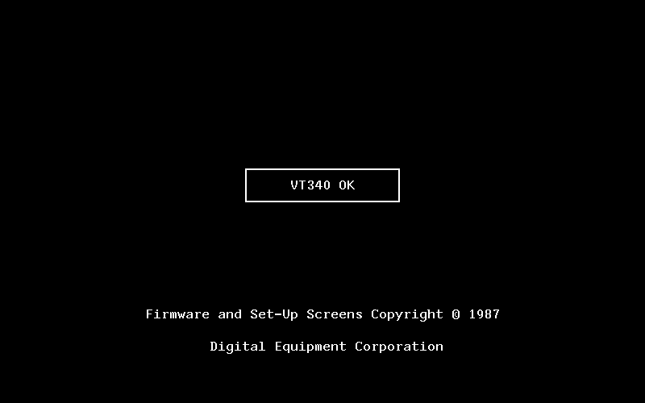
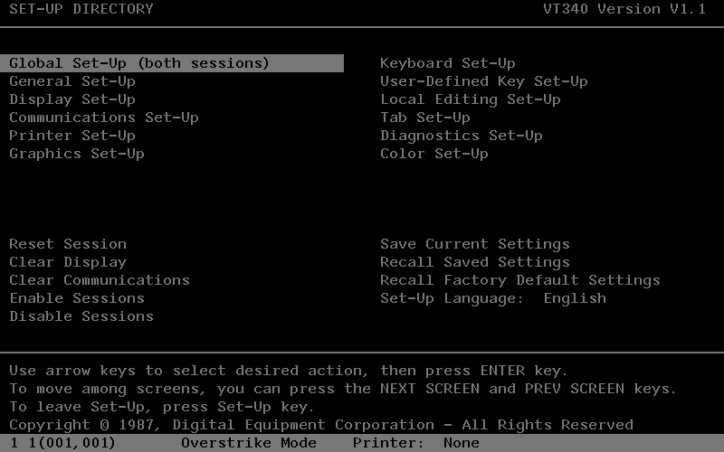
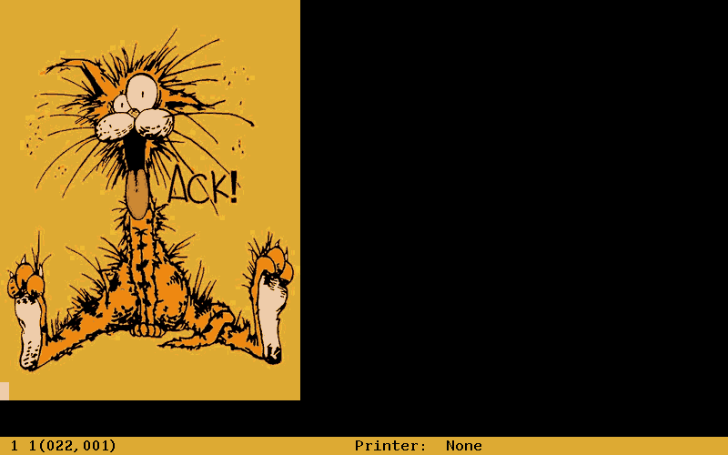
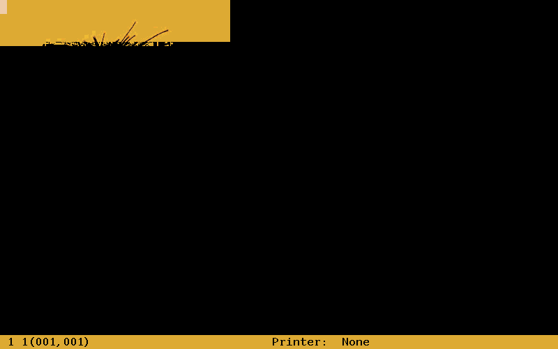
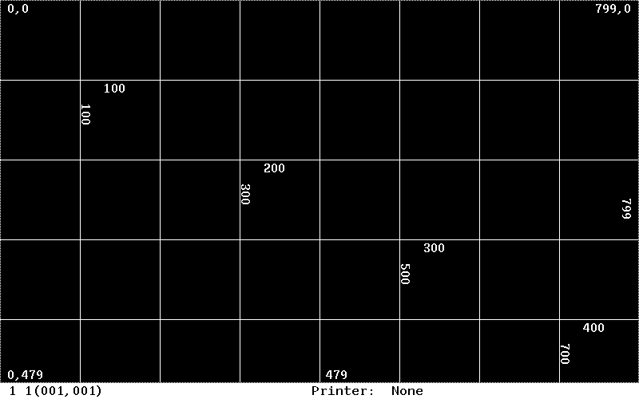
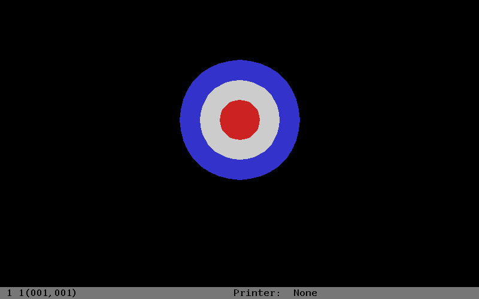
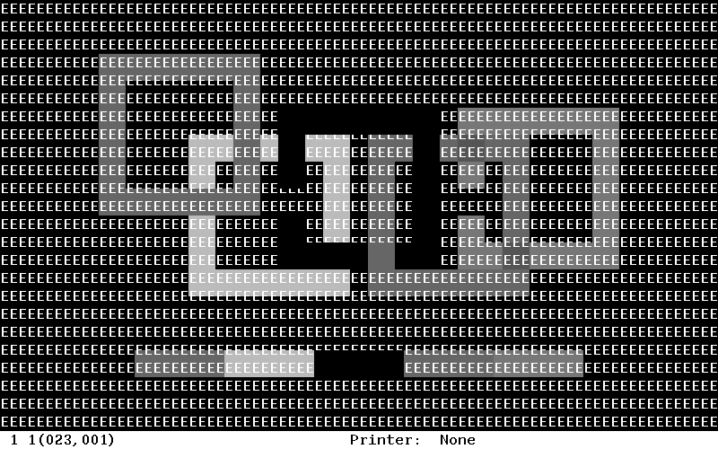
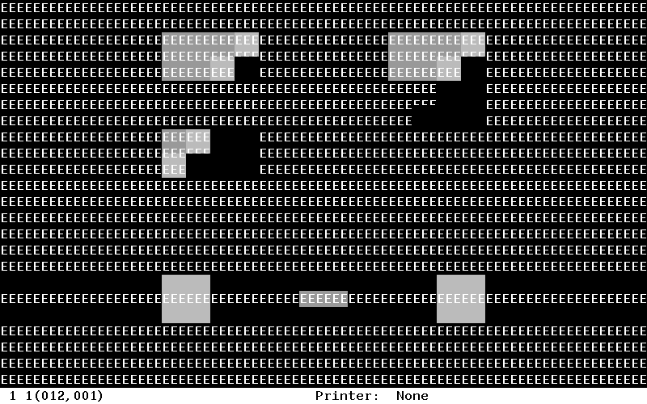
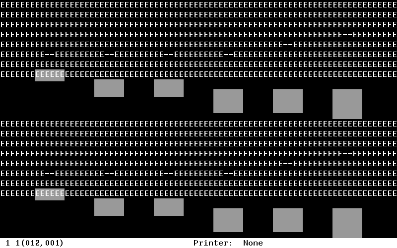
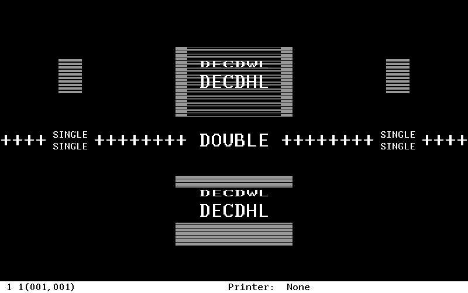

# VT340 emulator gallery

These are native DEC firmware results from the ROM-level VT340 MAME driver.
The gallery uses emulator screenshots captured by regression tests; reference
input images are not substituted for terminal output.

## Native cold boot

The terminal performs its normal cold boot, displays the temporary `Wait`
message, clears the screen, and reaches the persistent `VT340 OK` panel. The
animation samples the real display every two seconds of emulation time; it
does not patch or accelerate the firmware.


The two keyframes are also available as static regression evidence:




## Feature tour

This short slideshow collects the implemented Set-Up, ReGIS, color SIXEL, and
SIXEL editing/scrolling results shown individually below.


## Firmware and Set-Up

### Native Set-Up directory



The Set-Up directory, selection bar, help text, status line, and saved E80
configuration are all generated by the original terminal firmware.

## Color SIXEL



This is the complete 93,198-byte `bill-the-cat.six` fixture sent through the
Comm 1 PTY. The passing regression requires byte-exact reception, native
processor-to-bitmap and linear-pattern DC323 commands, and all sixteen
framebuffer color indices. The unused right half is expected because the
source image is narrower than the 800-pixel terminal display.

The focused color-index checkpoint below captures the beginning of the same
stream and is retained as diagnostic evidence that all sixteen indices become
active early in the transfer.



## ReGIS

### Coordinate grid, patterned vectors, and rotated text



### RAF nested-circle fill test



Both images come from the external `vt340test` corpus, sent through the real
serial and firmware command paths and checked with deterministic framebuffer
hashes. RAF additionally enters native VT340 color mode through Set-Up and
pins the rendered screenshot, preserving its intended red, white, and blue
palette rather than accepting the same indices through a monochrome map.

## SIXEL conformance scenes

These intentionally busy images are end states from focused conformance
programs. Their test value is the interaction between bitmap graphics and the
terminal's text backing store, margins, editing operations, and line modes.

### Transparent overlap and palette selection



### Insert/delete editing and bitmap movement



### Scrolling regions and graphic newline



### Double-width/double-height line attributes



## Reproducing captures

Build `vt340`, install the private ROM profile described in `../BUILDING.md`,
and run from the MAME checkout root.

```sh
# Regenerate the native cold-boot animation.
vt340-research/gallery/capture-boot.sh ./vt340

# Recreate the underlying passing feature results.
vt340-research/tests/run.py run \
  graphics-raster-commands setup-screen conformance \
  sixel-color-indices sixel-bill-pty --binary ./vt340

# Verify tracked assets, dimensions, animation frame counts, hashes, and links.
vt340-research/tests/run.py run gallery-assets
```

`tools/pngs_to_gif.py` converts MAME's PNG output using only Python's standard
library. The checked-in GIFs therefore do not require ffmpeg, ImageMagick, or
an online service to regenerate.

## Provenance

`manifest.json` records the producing regression, run identifier, Git revision,
dimensions, animation frame counts, and SHA-256 for every tracked asset. The
gallery validation test fails if an asset changes without an explicit
provenance update.
