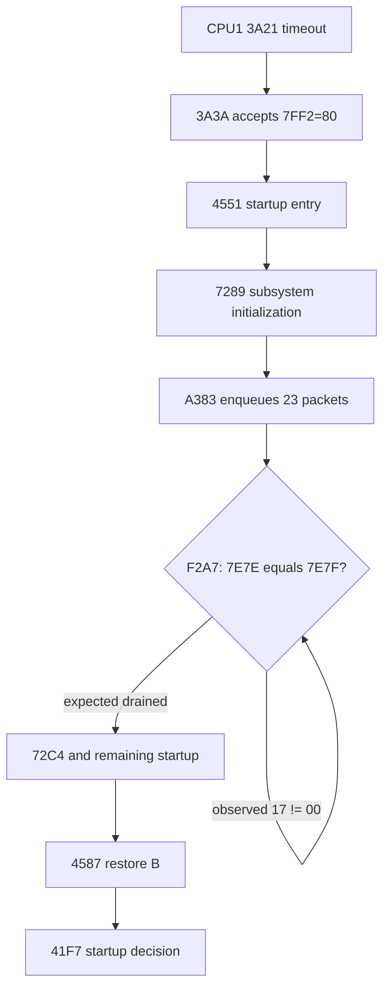

# Phase 4 post-timeout screen and CPU2 ring-service trace

## Scope

This diagnostic round followed an unmodified cold boot beyond CPU1's bounded
`7ff2` wait.  It observed CPU execution, shared-memory indices, DC323 command
writes, and framebuffer snapshots.  It did not force RAM, alter a signal,
change scheduler timing, or modify emulated hardware behavior.

The reproducible script is `phase4-post-timeout-screen.lua`.

## Current status

This report preserves the historical trace that exposed CPU2 interrupt
starvation after the timeout. The starvation described below was corrected by
removing the PC-qualified DC323 bit-0 substitution; subsequent E80, SCN2681,
SCN2641, PBT, and frame-erase work now produces persistent `VT340 OK` with
POST result `00`.

The timeout itself is still current. CPU2 publishes `7ff2=00` at 8.228779 s,
CPU1 overwrites it with stale-zero guard `10` at 8.295773 s, and CPU1 does not
advance until its bounded wait expires at 119.955290 s. The historical
failure after that point is resolved; the missed fast checkpoint is not.

The duration is now fully accounted for. The `3a18-3a1f` 24-bit loop has a
bare 12 MHz instruction time of 100.794880 seconds, reproduced exactly when
Timer 0 is masked only after loop entry. Normal timer service adds 10.850739
seconds. The apparent 120-second delay is therefore the authentic fallback
path plus prior startup, not an emulation slowdown. See
`phase4-timeout-cost-summary.txt`.

## Result

The terminal still displays `Wait`.  CPU1 does accept CPU2's authentic
`7ff2=80` result and enters `4551`, but `4551` is the entry to a substantial
startup routine, not the final success-screen transition.  That routine
blocks in its first call to `7289` because CPU2 does not consume the startup
packet ring.

Snapshots at 115, 119, 120, 121, 125, 130, 140, 160, 180, 240, and 300
emulated seconds were byte-identical (SHA-256
`a6fd5584aa6249ea7b977a00758f6041dcf9929eea4a60cf177375adc33f59df`).
No DC323 data/command-port writes occurred from 115 through 301 seconds.

## Native path after the mailbox timeout

| Time (s) | CPU1 PC | Event |
|---:|---:|---|
| 119.955290 | `3a21` | bounded checkpoint wait exits with `A=80` |
| 119.995537 | `3a31` | result wait observes retained `80` |
| 119.995541 | `3a3a` | result classified |
| 119.995547 | `4551` | startup routine entered with `B=40` |
| 120.025857 | `4578` | preliminary initialization complete |
| 120.025859 | `7289` | first large subsystem initialization entered |
| 120.026617 | `72b3` | packet construction begins |
| 120.026667-120.026862 | `a383` | producer advances `00` to `0e` |
| 120.026882 | `72b8` | first construction burst complete |
| 120.027190-120.027310 | `a383` | producer advances `0e` to `17` |
| after 120.027310 | `f2a7-f2d7` | waits for producer/consumer equality |
| 301.003791 | — | producer remains `17`, consumer remains `00` |

CPU1 therefore never returns to `457b`, never restores `B` at `4587`, and
never reaches the later decision at `41f7` or command-32 constructor at
`48f6`.

## CPU2 starvation

During the failed interval CPU2 continually executes the external-interrupt
save/restore path at `0003 -> 0091 -> 0040`, the DC323 service path at
`0047 -> 03e1`, and returns through `00cf -> 0090`.  The handler writes
`f003=fd` at `03eb` approximately every 132 microseconds, about 7,576 times
per emulated second.  This is immediate level-triggered re-entry, not the
approximately 59.89 Hz frame cadence.

The driver currently does all of the following:

1. The frame callback sets DC323 status bits 0 and 1 and asserts CPU2 INT0.
2. A read of DC323 register 3 specifically at CPU2 PC `0047` forcibly clears
   returned bit 0.
3. Firmware takes `004a -> 03e1` and writes `fd` to register 3.
4. The model applies `m_adder_status &= fd`; bit 0 consequently remains set.
5. Because enabled status remains set, INT0 is not cleared and the 8031
   immediately re-enters the handler after `RETI`.

CPU2 can no longer reach its operational ring consumer.  This directly
explains `7e7f=00`, CPU1's wait inside `f2a7`, the absence of late DC323
commands, and the unchanged `Wait` framebuffer.

## Revised Phase 4 boundary

The `7ff2` ordering mismatch still adds approximately 112 seconds, but it is
not the last blocker.  After the timeout CPU1 progresses correctly until it
requires CPU2 to drain its newly created packet ring.  The current
PC-qualified DC323 status/acknowledgement model then starves CPU2.

The next controlled work should reconstruct DC323 register-3 status polarity,
which conditions map to bits 0 and 1, and the write-to-clear convention used
by the `0040` interrupt dispatcher.  A diagnostic experiment should change
only the identified status/acknowledgement condition and require CPU2 itself
to advance `7e7f`; it must not advance the ring, render `VT340 OK`, or trigger
success from a firmware PC.

## Corrected path

That controlled experiment identified the cause. The sticky status and
write-zero-to-clear implementation was correct, but an older PC-qualified
substitution forced bit 0 low only for the read at `0047`. Removing that
substitution lets the firmware observe the actual pending bits:

- With Pause Complete set, `0047` sees bit 0 high, takes `004d`, and writes
  `fe`, clearing bit 0.
- If Scroll Service remains pending, the level interrupt re-enters once,
  `0047` sees bit 0 low, takes `03e1`, and writes `fd`, clearing bit 1.
- With both enabled pending bits cleared, the driver releases INT0. CPU2
  returns to its operational dispatcher instead of re-entering indefinitely.

Two repeated cold boots produced identical checkpoints:

| Time (s) | Event | Ring state |
|---:|---|---|
| 120.059199 | first `7289` packet burst drained; CPU1 exits `f2a7` | `17/17` |
| 120.288055 | both `7289` passes complete; CPU1 reaches `4587` | `54/54` |
| 121.688120 | CPU1 submits command 32 | `58/58` |
| 121.691819 | CPU2 enters native `db98` handler | `66/66` |
| 122.047438 | CPU2 reaches `dc02` | `66/66` |

Each run recorded 102 producer advances and 102 authentic CPU2 consumer
advances. Between 110 seconds and `dc02`, the dispatcher issued 722 `fe` and
722 `fd` acknowledgements, no other acknowledgement values, with an aggregate
mean interval of 8.343499 ms (two serviced conditions per approximately
16.687 ms frame). This closes CPU2 packet starvation without modifying the
ring or scheduling.

The next boundary is the already identified command-32 completion wait:
CPU2 reaches `dc02` with producer equal to consumer and `60bb=01`. The packet
drain fix is therefore successful and separate from the later event that must
take `dc18` and clear the `Wait` latch.
